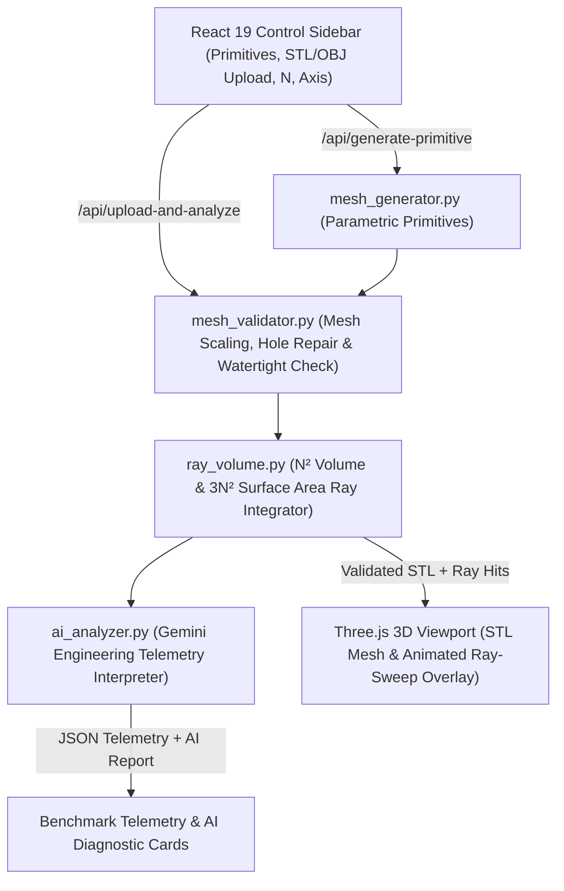

# Ramesh · Ray-Cast Mesh Benchmarking

**Ramesh** (*Ray-Cast Mesh Benchmarking*) is an interactive 3D computational geometry and numerical integration workbench. It generates parametric 3D primitives or ingests custom `.STL`/`.OBJ` CAD meshes, repairs and validates mesh topology, numerically integrates **volume** and **surface area** using high-density discrete ray-casting grids, and benchmarks those numerical approximations against exact analytical/polyhedral ground-truth references—complete with real-time 3D ray visualization and AI-driven engineering diagnostics powered by Google Gemini.

---

## Features and Functionality

### Key Features
- **Dual Geometry Pipeline:**
  - **Parametric Primitives:** Instant generation of spheres, cuboids, tori, cylinders, and regular $k$-sided pyramids/cones from exact geometric parameters.
  - **Custom CAD Mesh Upload:** Drag-and-drop `.STL` and `.OBJ` support (up to 20 MB) with independent non-uniform $X, Y, Z$ scale factors (`1–100`), automatic hole-filling, winding repair, and watertightness verification.
- **Configurable Ray-Cast Numerical Integration:**
  - Adjustable ray grid density $N \in [8, 1024]$ ($N^2$ rays per axis, up to 1,048,576 rays per pass and 3,145,728 total rays across 3 axes).
  - Selectable primary integration axis ($X$, $Y$, or $Z$) to investigate how mesh orientation and grazing angles affect numerical convergence.
- **Interactive Three.js 3D Viewport:**
  - Real-time client-side `.STL`/`.OBJ` preview and live scaling before server submission.
  - Animated ray-sweep visualization displaying representative entry/exit chords, hit points, and interior segments across the mesh.
- **AI Engineering Interpretation (Gemini):**
  - Translates raw benchmark telemetry (volume/surface-area percentage errors, ray hit ratios, mesh repair status, and execution time) into a concise 4-point engineering report covering *Accuracy Assessment*, *Geometric Drivers*, *Sampling Guidance*, and *Mesh Quality*.

### Mesh Topology Validation & Hole Repair

Before running ray-cast integration, every uploaded `.STL` or `.OBJ` mesh must form a closed, watertight 2-manifold so that every ray entering the solid is guaranteed to exit it. Ramesh automatically detects and repairs missing faces through a four-stage topological pipeline:

1. **Boundary Edge Detection (The 2-Triangle Rule):** In a watertight 2-manifold mesh, every interior edge is shared by exactly two adjacent triangles. After welding coincident vertices, the validator scans the mesh adjacency graph and flags any edge attached to only a single triangle as an open **boundary edge**.
2. **Boundary Loop Tracing (Finding the Rim):** The repair engine chains connected boundary edges tip-to-tail to isolate each closed **boundary loop** representing the exact perimeter of a hole:
3. **Hole Triangulation (Sealing the Loop):** Each boundary loop is capped with new triangles using one of two methods depending on loop geometry:
   - **Planar Ear Clipping / Polygon Triangulation:** For flat or small boundary rings, the algorithm iteratively clips three consecutive rim vertices into a new triangle, removing the middle vertex and shrinking the loop until the entire opening is tiled.
   - **Best-Fit Plane Projection:** For warped or non-planar 3D holes, the rim vertices are projected onto their least-squares best-fit 2D plane, triangulated via constrained 2D polygon triangulation, and mapped back to their original 3D vertex coordinates.
4. **Winding & Normal Alignment:** Newly synthesized patch triangles and existing mesh faces are traversed across shared edges to enforce consistent counter-clockwise outward winding, ensuring all surface normals point away from the interior volume.

### Mathematical Formulation

#### 1. Ray-Cast Volume Integration (Entry/Exit Chord Summation)
Given an axis-aligned bounding box with cross-sectional dimensions $W \times H$ perpendicular to the chosen scan direction $\hat{d}$, Ramesh partitions the projection plane into an $N \times N$ uniform grid where each cell has area:

$$
\Delta A = \frac{W \cdot H}{N^2}
$$

Through each grid cell $(i, j)$, a parallel ray is cast from just outside the bounding box:

$$
\mathbf{r}_{i,j}(t) = \mathbf{o}_{i,j} + t\hat{d}
$$

Each ray origin $\mathbf{o}$ is offset from the exact cell midpoint by a tiny deterministic sub-cell shift ($+0.00013\,\Delta u, +0.00037\,\Delta v$) to prevent rays from lying directly on symmetry planes or pyramid silhouette edges.

All ray-triangle intersection coordinates along the scan axis are sorted in ascending order and deduplicated within a spatial tolerance $\tau$ ($10^{-7}$ of the bounding-box depth, min $10^{-8}$) so shared triangle edges and vertices are not double-counted:

$$
z_1 < z_2 < \dots < z_{2m}
$$

For a closed, watertight 2-manifold, the ray enters the solid on odd-indexed hits and exits on even-indexed hits. Summing the interior chord lengths across all $N \times N$ rays and multiplying by the cell area $\Delta A$ yields the Riemann volume estimator:

$$
V_{\text{est}} = \Delta A \sum_{i=1}^{N} \sum_{j=1}^{N} \sum_{k=1}^{m_{i,j}} \left(z_{2k}^{(i,j)} - z_{2k-1}^{(i,j)}\right)
$$

*(If a grazing tangency produces an odd hit count on a ray, the integrator falls back to signed face-normal orientation along the scan axis—entering when the normal component is negative and exiting when positive—to resolve interior intervals.)*

#### 2. Three-Axis Normal-Weighted Surface Area Integration (Cauchy-Crofton Formula)
A single ray direction $\hat{d}$ cannot measure faces parallel to $\hat{d}$ ($\hat{n} \cdot \hat{d} = 0$). Instead, Ramesh casts three orthogonal $N \times N$ ray grids along the $X$, $Y$, and $Z$ axes ($3N^2$ rays total).

A surface patch $dS$ with unit outward normal $\hat{n}$ projects onto the plane perpendicular to axis $\alpha$ with projected area proportional to the normal magnitude. Weighting every deduplicated ray-surface hit $h$ on axis $\alpha$ by the magnitude of its local normal component integrates the squared normal component over the surface:

$$
dA_\alpha = |n_\alpha| \, dS \quad \Longrightarrow \quad \int_{\partial \Omega} n_\alpha^2 \, dS \approx \Delta A_\alpha \sum_{h \in \text{Hits}(\alpha)} |n_\alpha(h)|
$$

Because $\hat{n}$ is a unit normal vector, its squared Cartesian components sum to unity:

$$
n_x^2 + n_y^2 + n_z^2 = 1
$$

Summing the normal-weighted contributions across all three orthogonal grids reconstructs the total surface area without directional bias or division by near-zero cosines:

$$
A_{\text{est}} = \sum_{\alpha \in (X,Y,Z)} \Delta A_\alpha \sum_{h \in \text{Hits}(\alpha)} |n_\alpha(h)| \approx \int_{\partial \Omega} (n_x^2 + n_y^2 + n_z^2) \, dS = \int_{\partial \Omega} dS
$$

#### 3. Ground-Truth Reference & Relative Error Benchmarking
To isolate numerical ray-sampling error from mesh tessellation effects, ray-cast estimates are benchmarked against the exact polyhedral volume (via the divergence theorem / signed tetrahedron summation) and exact triangle-area sum of the validated watertight mesh.

### System Architecture



---

## Code Repository & Setup Instructions

- **GitHub Repository:** [https://github.com/DivyanshSangwan/Ramesh](https://github.com/DivyanshSangwan/Ramesh)
- **Entire Repository:** [https://entire.com/gh/DivyanshSangwan/Ramesh](https://entire.com/gh/DivyanshSangwan/Ramesh)
- **Live Cloud Instance (Vultr):** [http://149.248.50.170](http://149.248.50.170)

### Local Setup

```bash
git clone https://github.com/DivyanshSangwan/Ramesh.git
cd Ramesh

# Python Backend Environment
python3 -m venv .venv
source .venv/bin/activate
python -m pip install -r requirements.txt -c constraints.txt

# Build React/Three.js Frontend
cd frontend
npm ci
npm run build
cd ..

# Configure Environment (Optional for AI Reports)
cp .env.example .env
# Edit .env and set GEMINI_API_KEY=your_api_key

# Run Server
python -m uvicorn backend.main:app --reload --port 8000
```

Open **http://127.0.0.1:8000** for the full application or **http://127.0.0.1:8000/docs** for the interactive OpenAPI documentation.

### Cloud Deployment (Docker + Vultr)

```bash
./deploy.sh <SERVER_IP>
```

---

## Technical Documentation

### Tech Stack
| Layer | Technologies Used |
| :--- | :--- |
| **Frontend** | React 19, Three.js (`STLLoader`, `OBJLoader`, `OrbitControls`), Vite 8, CSS3 Custom Properties |
| **Backend** | Python 3.12+, FastAPI, Pydantic v2, Uvicorn |
| **Computational Geometry** | `trimesh`, `numpy`, `scipy` (vectorized ray-triangle intersection & manifold validation) |
| **AI Integration** | Google GenAI SDK (`google-genai`), Gemini (`gemini-3.5-flash-lite` / `gemini-2.5-flash`) |
| **Infrastructure & DevOps** | Docker (multi-stage Node 22 + Python 3.12 build), Docker Compose, Vultr Cloud Compute, Entire CLI |

### Implementation Details
- **[`backend/mesh_generator.py`](backend/mesh_generator.py):** Constructs high-resolution `trimesh.Trimesh` primitives (`sphere`, `cuboid`, `torus`, `cylinder`, `pyramid_cone`) with validated dimension bounds (`10,000 cm` max) and centered bounding boxes.
- **[`backend/mesh_validator.py`](backend/mesh_validator.py):** Enforces a strict 20 MB streaming upload cap, applies non-uniform scaling matrices, fills missing faces (`trimesh.repair.fill_holes`), fixes normal/winding inversions (`trimesh.repair.fix_normals`, `fix_winding`), and rejects non-watertight or degenerate meshes before integration.
- **[`backend/ray_volume.py`](backend/ray_volume.py):** Implements vectorized $N \times N$ ray grid generation with deterministic sub-cell offsets (`+0.00013 dx`, `+0.00037 dy`) to avoid edge/vertex degeneracies, pairs entry/exit hits per ray for volume integration, and executes the 3-axis normal-weighted surface area estimator.
- **[`backend/ai_analyzer.py`](backend/ai_analyzer.py):** Builds a structured JSON prompt from the benchmark telemetry, enforces a sliding-window rate limit (120 reports/hour) to protect public cloud deployments, and falls back gracefully if Gemini is disabled or unreachable.
- **[`backend/main.py`](backend/main.py):** Exposes `/api/generate-primitive`, `/api/upload-and-analyze`, `/models/{filename}`, and `/api/health`, bounds concurrent heavy ray-casting jobs via a `BoundedSemaphore(2)`, and automatically prunes older `.stl` exports to cap disk usage.

---

## Future Scope and Improvements

1. **BVH / GPU-Accelerated Ray Casting (Embree / WebGPU):** Integrate Intel Embree (`pyembree` / `rtree`) on the backend or WebGPU compute shaders in the browser to scale ray grid densities beyond $N = 4096$ ($>16\text{M}$ rays) in sub-second runtimes.
2. **Adaptive Quadtree Sub-Sampling:** Dynamically subdivide grid cells near high-curvature silhouettes and thin features while keeping coarse cells on flat interior regions, achieving $O(N^2)$ accuracy with a fraction of the rays.
3. **Convergence Plotting & Multi-N Sweeps:** Add an automated convergence sweep mode that runs $N = 16, 32, 64, 128, 256, 512$ in parallel and plots log-log error convergence curves (relative error $\varepsilon$ vs. $N$).
