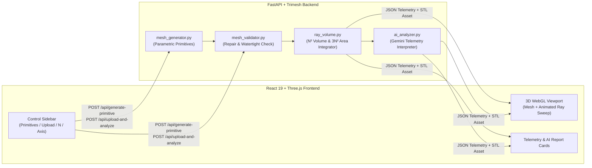

# Ramesh · Ray-Cast Mesh Benchmarking

**Ramesh** (*Ray-Cast Mesh Benchmarking*) is an interactive 3D computational geometry and numerical integration workbench. It generates parametric 3D primitives or ingests custom `.STL`/`.OBJ` CAD meshes, repairs and validates mesh topology, numerically integrates **volume** and **surface area** using high-density discrete ray-casting grids, and benchmarks those numerical approximations against exact analytical/polyhedral ground-truth references—complete with real-time 3D ray visualization and AI-driven engineering diagnostics powered by Google Gemini.

---

## Features and Functionality

### Key Features
- **Dual Geometry Pipeline:**
  - **Parametric Primitives:** Instant generation of spheres, cuboids, tori, cylinders, and regular $k$-sided pyramids/cones with exact analytical closed-form ground-truth formulas.
  - **Custom CAD Mesh Upload:** Drag-and-drop `.STL` and `.OBJ` support (up to 20 MB) with independent non-uniform $X, Y, Z$ scale factors (`1–100`), automatic hole-filling, winding repair, and watertightness verification.
- **Configurable Ray-Cast Numerical Integration:**
  - Adjustable ray grid density $N \in [8, 1024]$ ($N^2$ rays per axis, up to 1,048,576 rays per pass and 3,145,728 total rays across 3 axes).
  - Selectable primary integration axis ($X$, $Y$, or $Z$) to investigate how mesh orientation and grazing angles affect numerical convergence.
- **Interactive Three.js 3D Viewport:**
  - Real-time client-side `.STL`/`.OBJ` preview and live scaling before server submission.
  - Animated ray-sweep visualization displaying representative entry/exit chords, hit points, and interior segments across the mesh.
- **AI Engineering Interpretation (Gemini):**
  - Translates raw benchmark telemetry (volume/surface-area percentage errors, ray hit ratios, mesh repair status, and execution time) into a concise 4-point engineering report covering *Accuracy Assessment*, *Geometric Drivers*, *Sampling Guidance*, and *Mesh Quality*.

### Mathematical Formulation

#### 1. Ray-Cast Volume Integration (Entry/Exit Chord Summation)
Given an axis-aligned bounding box of cross-sectional dimensions $L_u \times L_v$ orthogonal to ray direction $\hat{d} \in (\hat{x}, \hat{y}, \hat{z})$, Ramesh partitions the plane into an $N \times N$ uniform grid of cell area:

$$\Delta A = \frac{L_u \cdot L_v}{N^2}$$

A ray $R_{i,j}(t) = \mathbf{o}_{i,j} + t\hat{d}$ is cast through the jittered center of each grid cell $(i, j)$ to avoid degenerate silhouette/edge tangencies. Ray-triangle intersections along $R_{i,j}$ are sorted by depth $t_1 \le t_2 \le \dots \le t_{2m}$ and deduplicated within a spatial tolerance $\varepsilon$. By the Jordan Curve / parity theorem for a closed 2-manifold, consecutive pairs $(t_{2k-1}, t_{2k})$ form interior chords of length $\Delta t_k = t_{2k} - t_{2k-1}$, yielding the Riemann volume estimator:

$$V_{\text{est}} = \Delta A \sum_{i=1}^{N} \sum_{j=1}^{N} \sum_{k=1}^{m_{i,j}} \left(t_{2k}^{(i,j)} - t_{2k-1}^{(i,j)}\right)$$

#### 2. Three-Axis Cauchy-Crofton Surface Area Integration
A single ray direction $\hat{d}$ cannot observe faces parallel to $\hat{d}$ ($\hat{n} \cdot \hat{d} = 0$). A surface element $dS$ with unit normal $\hat{n} = (n_x, n_y, n_z)$ projects onto the plane orthogonal to axis $\alpha \in (x, y, z)$ with projected area $dA_\alpha = |n_\alpha| \, dS$. Weighting each ray-surface intersection on axis $\alpha$ by its local normal component $|n_\alpha|$ integrates $n_\alpha^2 \, dS$:

$$\int_{\partial \Omega} n_\alpha^2 \, dS \approx \Delta A_\alpha \sum_{\text{hits } h \text{ on } \alpha} |n_\alpha(h)|$$

Because $\hat{n}$ is a unit normal ($n_x^2 + n_y^2 + n_z^2 = 1$), summing across all three orthogonal grids ($3N^2$ rays total) recovers the total surface area without angular bias:

$$A_{\text{est}} = \sum_{\alpha \in (x,y,z)} \Delta A_\alpha \sum_{\text{hits } h \text{ on } \alpha} |n_\alpha(h)| \approx \int_{\partial \Omega} (n_x^2 + n_y^2 + n_z^2) \, dS = \int_{\partial \Omega} dS$$

#### 3. Relative Error Benchmarking
Estimated quantities are compared against analytical closed-form references (for parametric primitives) or divergence-theorem polyhedral integrals (for custom meshes):

$$\varepsilon_{\text{rel}} = 100 \times \frac{|\text{Estimate} - \text{Reference}|}{\text{Reference}}$$

### System Architecture



---

## Code Repository & Setup Instructions

- **GitHub Repository:** [https://github.com/DivyanshSangwan/Ramesh](https://github.com/DivyanshSangwan/Ramesh)
- **Entire Repository:** [https://entire.com/gh/DivyanshSangwan/Ramesh](https://entire.com/gh/DivyanshSangwan/Ramesh)
- **Live Cloud Instance (Vultr):** [http://149.248.50.170](http://149.248.50.170)

### Local Setup

```bash
git clone https://github.com/DivyanshSangwan/Ramesh.git
cd Ramesh

# Python Backend Environment
python3 -m venv .venv
source .venv/bin/activate
python -m pip install -r requirements.txt -c constraints.txt

# Build React/Three.js Frontend
cd frontend
npm ci
npm run build
cd ..

# Configure Environment (Optional for AI Reports)
cp .env.example .env
# Edit .env and set GEMINI_API_KEY=your_api_key

# Run Server
python -m uvicorn backend.main:app --reload --port 8000
```

Open **http://127.0.0.1:8000** for the full application or **http://127.0.0.1:8000/docs** for the interactive OpenAPI documentation.

### Cloud Deployment (Docker + Vultr)

```bash
./deploy.sh <SERVER_IP>
```

---

## Technical Documentation

### Tech Stack
| Layer | Technologies Used |
| :--- | :--- |
| **Frontend** | React 19, Three.js (`STLLoader`, `OBJLoader`, `OrbitControls`), Vite 8, CSS3 Custom Properties |
| **Backend** | Python 3.12+, FastAPI, Pydantic v2, Uvicorn |
| **Computational Geometry** | `trimesh`, `numpy`, `scipy` (vectorized ray-triangle intersection & manifold validation) |
| **AI Integration** | Google GenAI SDK (`google-genai`), Gemini (`gemini-3.5-flash-lite` / `gemini-2.5-flash`) |
| **Infrastructure & DevOps** | Docker (multi-stage Node 22 + Python 3.12 build), Docker Compose, Vultr Cloud Compute, Entire CLI |

### Implementation Details
- **[`backend/mesh_generator.py`](backend/mesh_generator.py):** Constructs high-resolution `trimesh.Trimesh` primitives (`sphere`, `cuboid`, `torus`, `cylinder`, `pyramid_cone`) and computes exact analytical volume and surface area using closed-form geometry equations independent of mesh tessellation.
- **[`backend/mesh_validator.py`](backend/mesh_validator.py):** Enforces a strict 20 MB streaming upload cap, applies non-uniform scaling matrices, fills missing faces (`trimesh.repair.fill_holes`), fixes normal/winding inversions (`trimesh.repair.fix_normals`, `fix_winding`), and rejects non-watertight or degenerate meshes before integration.
- **[`backend/ray_volume.py`](backend/ray_volume.py):** Implements vectorized $N \times N$ ray grid generation with deterministic sub-cell jitter ($\pm 10^{-5}$ cell width) to avoid edge/vertex degeneracies, pairs entry/exit hits per ray for volume integration, and executes the 3-axis normal-weighted surface area estimator.
- **[`backend/ai_analyzer.py`](backend/ai_analyzer.py):** Builds a structured JSON prompt from the benchmark telemetry, enforces a sliding-window rate limit (120 reports/hour) to protect public cloud deployments, and falls back gracefully if Gemini is disabled or unreachable.
- **[`backend/main.py`](backend/main.py):** Exposes `/api/generate-primitive`, `/api/upload-and-analyze`, `/models/{filename}`, and `/api/health`, bounds concurrent heavy ray-casting jobs via a `BoundedSemaphore(2)`, and automatically prunes older `.stl` exports to cap disk usage.

---

## Future Scope and Improvements

1. **BVH / GPU-Accelerated Ray Casting (Embree / WebGPU):** Integrate Intel Embree (`pyembree` / `rtree`) on the backend or WebGPU compute shaders in the browser to scale ray grid densities beyond $N = 4096$ ($>16\text{M}$ rays) in sub-second runtimes.
2. **Adaptive Quadtree Sub-Sampling:** Dynamically subdivide grid cells near high-curvature silhouettes and thin features while keeping coarse cells on flat interior regions, achieving $O(N^2)$ accuracy with a fraction of the rays.
3. **Convergence Plotting & Multi-N Sweeps:** Add an automated convergence sweep mode that runs $N = 16, 32, 64, 128, 256, 512$ in parallel and plots log-log error convergence curves ($\varepsilon_{\text{rel}}$ vs. $N$).
